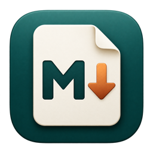

<p align="center"></p>

# 免费版md

让文字，回到自己手中。一款免费的 macOS 本地 Markdown 工作台，使用 AppKit / NSTextView 原生界面和 WKWebView 离线预览。

[下载主页](https://serphen591.github.io/free-md/) · [下载 v1.0.1 通用版 DMG](https://github.com/serphen591/free-md/releases/download/v1.0.1/FreeMD-1.0.1-universal.dmg) · [版本记录](https://github.com/serphen591/free-md/releases) · [反馈问题](https://github.com/serphen591/free-md/issues)

## 安装

需要 macOS 12 或更新版本，同时支持 Apple Silicon 与 Intel。打开 DMG，将“免费版md”拖入 Applications 文件夹即可；运行时无需 Node.js、Swift 或 Taio。

当前版本使用 ad hoc 签名，尚无 Apple Developer ID 签名或公证。若 macOS 提示无法验证开发者，请确认下载来源可信后，按 [Apple 的说明](https://support.apple.com/zh-cn/102445) 前往“系统设置 → 隐私与安全性 → 仍要打开”。不需要关闭系统安全保护。

安装包不包含作者的文档、片段、用户设置或开发依赖。详细使用方式见[安装与使用说明](安装与使用说明.txt)。

## 功能

- 本地 Markdown、纯文本与 JSON 编辑，多文档、文件夹浏览、搜索、文档大纲。
- 编辑、双栏与预览模式；离线渲染表格、任务列表、代码高亮、KaTeX 公式和 Mermaid 图表。
- 鼠标悬浮在已打开的文档行上时显示“×”，点击关闭对应文档；有未保存内容时提示保存、取消或不保存。
- 手动收藏文本片段，13 项内置文本动作，正则查找替换。
- HTML / PDF 导出，TextBundle 打开，TextPack / ZIP 文本导入。
- 草稿恢复、外部修改冲突提示，支持 UTF-8、UTF-16 和可识别的 GB18030 文本。

文档直接保存在你指定的位置。草稿、片段与导入副本保存在 `~/Library/Application Support/免费版md/`；没有账户或文档上传服务。请使用 ⌘S 保存到文件，草稿备份不会自动写回原文件。远程图片默认不加载。

在访达中选中 `.md` 文件，进入“显示简介 → 打开方式 → 免费版md → 全部更改”，即可设置默认打开方式。安装不会自动更改其他电脑的文件关联。

## 范围

免费版md 是独立实现的本地应用，与 Taio 没有隶属关系。当前不提供 iCloud 同步、Taio / JSBox 脚本执行、Siri 或 Widget 扩展；`.taioactions` 文件可作为 JSON 查看和编辑。普通文本文件上限为 20 MB，目录列表最多显示 2,000 个受支持文件。

## 从源码构建

需要 macOS、Apple Command Line Tools（Swift）和 Node.js 22.12 或更新版本。依赖版本固定在 `package-lock.json` 中。

```sh
npm ci
./scripts/build.sh
./scripts/package.sh
```

输出：`build/免费版md.app` 与 `release/FreeMD-1.0.1-universal.dmg`。构建同时生成 arm64 / x86_64，部署目标为 macOS 12。第三方依赖的许可原文随应用打包在 `Contents/Resources/ThirdPartyLicenses.txt` 中。

## 验证

```sh
npm test
mkdir -p build
swiftc -swift-version 5 Sources/Core.swift tests/main.swift -o build/core-tests
build/core-tests
```

测试覆盖编码保真、文档大纲、文本动作、草稿序列化、预览安全过滤与导出模板。

## 项目结构

| 路径 | 内容 |
| --- | --- |
| `Sources/Core.swift` | 文档模型、编码、大纲与文本动作 |
| `Sources/App.swift` | 原生界面、文件操作、保存保护、片段与导出 |
| `Sources/Preview.swift` | WebKit 预览及受限的本地图片读取 |
| `Sources/Archive.swift` | 有大小限制的 ZIP / TextPack 导入 |
| `Resources/preview-source.js` | Markdown、公式、图表与安全过滤 |
| `docs/` | 无框架、无外部运行依赖的 GitHub Pages 下载主页 |
| `scripts/` | 构建、资源打包与 DMG 生成 |

